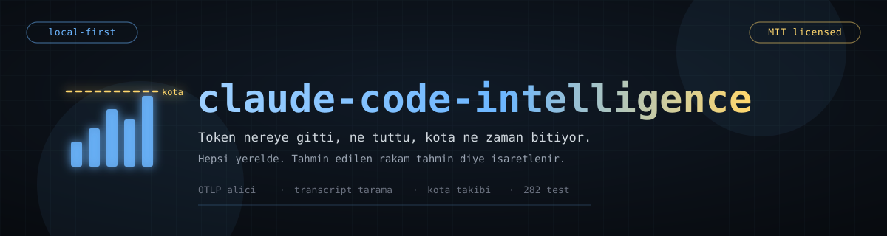
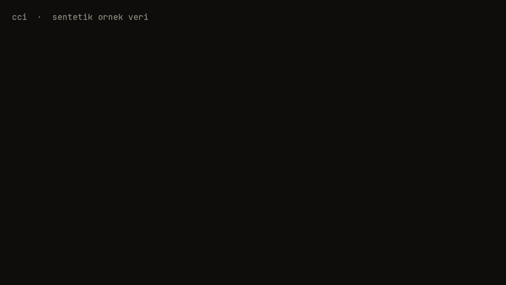
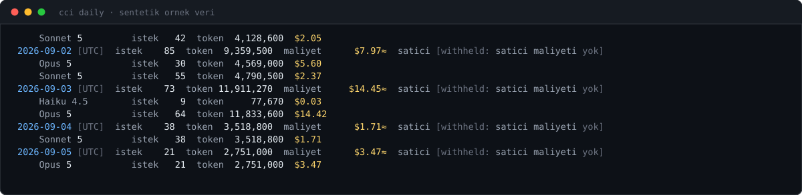
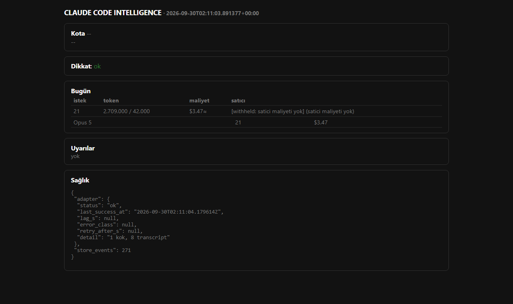

# claude-code-intelligence

<details>
<summary><b>In English</b></summary>

<br>

**Where your Claude Code tokens went, what they cost, and when the quota resets.** It is a local-first layer that observes, normalises, forecasts and alerts on AI coding-agent usage. Claude Code comes first; the architecture takes other providers as adapters. The rest of this README is in Turkish.

- **No content, by construction.** Prompts, responses, tool arguments and file contents are not defined in any type, so a privacy review is a `grep`.
- **Local-first.** The network inventory has two targets: the quota endpoint and an optional price refresh. The OTLP receiver listens on `127.0.0.1`. Nothing is exported without explicit consent.
- **An evidence class on every number:** observed, derived, vendor-estimated, estimated, predicted or inferred. A cost derived from list prices is marked `≈`, and where a vendor does not report its own cost the figure is `[withheld]` rather than invented.
- **Conservation law.** Every report satisfies `total = Σ parts`; `--strict` exits 3 when one does not.
- **The quota poll uses your Claude Code login.** `cci quota --poll`, and `cci run` unless you pass `--no-quota`, read the OAuth access token from Claude Code's credentials file (`~/.claude/.credentials.json`, or under `CLAUDE_CONFIG_DIR`). They send it to `https://api.anthropic.com/api/oauth/usage`, an endpoint Anthropic does not document, so it can change or disappear without notice. Details: [The quota endpoint](#kota-ucu-ne-okunur-ne-gönderilir).
  - **Sent:** one `GET` with no body. Headers: `Authorization: Bearer <token>`, `anthropic-beta: oauth-2025-04-20`, `Accept: application/json` and `User-Agent: cci/<version>`. No transcripts, prompts, project paths or usage records are sent.
  - **Kept:** the token stays in memory and is never written to disk or logs. cci never refreshes or rotates it.
  - **Stored:** the parsed quota windows, plus a SHA-256 of the raw response, in the local database.
  - **No network:** plain `cci quota` (without `--poll`) only reads what is already stored.

```bash
uv tool install git+https://github.com/Furkiozknn/claude-code-intelligence
cci scan && cci daily          # read Claude Code transcripts; requests, tokens, estimated cost per day
cci quota --forecast           # when the limit is hit at this pace (needs 5+ polled cycles)
cci snapshot && cci serve      # local dashboard
```

</details>

**Claude Code kullanımınızın nereye gittiğini gösterir: hangi gün, hangi modelde kaç token gitti, tahmini maliyeti ne, kota ne zaman bitecek.** Bilgisayarınızdaki transcript'leri okur; prompt ya da yanıt içeriğine bakmaz. Ağ erişimi yalnız kota ucu ve isteğe bağlı fiyat yenilemeyle sınırlı.

```bash
uv tool install git+https://github.com/Furkiozknn/claude-code-intelligence   # ya da tek seferlik: uvx --from git+https://github.com/Furkiozknn/claude-code-intelligence cci daily
cci scan && cci daily
```

Temiz makinede ölçülen süre: kurulum ~9 sn, ilk sonuç (`scan` + `daily`) kurulumdan sonra ~4 sn (boş `uv` önbelleği, 271 kayıtlık örnek veri; ayrıntı: [`docs/DENETIM.md`](docs/DENETIM.md)).



<sub>**Sentetik örnek veri.** Bu demo ve aşağıdaki görseller kimsenin gerçek kullanımından üretilmedi:
[`scripts/ornek-veri.py`](scripts/ornek-veri.py) uydurma bir Claude Code kaydı yazar, komutlar onun üzerinde
gerçekten çalıştırılır ([`scripts/demo-uret.py`](scripts/demo-uret.py)); çıktı elle yazılmadı.
Yazılan sayılar ölçüm değil, örnektir. `≈` maliyetin liste fiyatından türetilmiş bir tahmin olduğunu,
**`[withheld]`** satıcının kendi maliyetini vermediği yerde bir sayı uydurulmadığını söyler.</sub>

| Ne zaman kullanılır | Ne zaman kullanılmaz |
|---|---|
| "Bu hafta tokenlarım nereye gitti?" sorusuna kendi bilgisayarındaki kayıtlardan cevap arıyorsan | Fatura ya da resmî harcama belgesi gerekiyorsa: maliyet liste fiyatından türetilmiş **tahmindir**, faturanın yerine geçmez |
| Kota limitine ne zaman çarpacağını görmek, uyarı almak istiyorsan | Ekip ya da kurum düzeyinde merkezî izleme istiyorsan: veri tek makinede kalır |
| Sayılara güvenip güvenemeyeceğini kontrol etmek istiyorsan (`cci doctor`, `--strict`) | Prompt/yanıt içeriğini analiz etmek istiyorsan: bu araç içeriği bilerek tanımlamaz |

<p align="center"></p>

AI coding agent kullanımını (önce Claude Code, mimari olarak diğer
sağlayıcılar) **gözlemleyen, normalize eden, analiz eden, ölçen, tahmin
eden, anomali tespit eden, uyaran ve "şu anda ne yapmalıyım?" sorusuna
veriye dayalı cevap veren** yerel-öncelikli bir istihbarat/kontrol katmanı.

Bu bir usage monitor, token sayacı, kota görüntüleyici, pano, CLI aracı
veya taskbar widget'ı **değildir** — bunların birleşiminden büyük bir sistem
hedefleniyor.

## Hızlı başlangıç

Yerel-öncelikli pano: Claude Code transcript'lerini tarar, bir anlık görüntü
üretir ve tarayıcıda gösterir.

```
uv tool install git+https://github.com/Furkiozknn/claude-code-intelligence
cci scan
cci snapshot
cci serve
```

Kaynaktan çalışmak isteyenler: `git clone` sonrası `uv sync`, komutların başına `uv run` ekleyin.



<sub>Panonun kendisi, yukarıdaki dört komut sentetik örnek veri üzerinde çalıştırıldıktan sonra.
`kota` boş: kota ucu yalnız `cci quota --poll` ile (kimlik dosyanız varsa) sorgulanır.</sub>

## Kota ucu: ne okunur, ne gönderilir

Kota verisi, Claude Code'un kendi oturum bilginizle alınır. Bunu açıkça bilmeniz gerekir:

- **Hangi komutlar:** `cci quota --poll` ve `cci run`. `cci run` kimlik dosyası varsa kotayı varsayılan olarak sorgular; kapatmak için `--no-quota` verin. `--poll` olmadan `cci quota` ağa çıkmaz, yalnız saklanmış son değeri okur.
- **Ne okunur:** Claude Code'un kimlik dosyası `~/.claude/.credentials.json` (`CLAUDE_CONFIG_DIR` ayarlıysa onun altındaki). Dosyadan yalnız `claudeAiOauth` altındaki `accessToken`, `expiresAt`, `subscriptionType` ve `rateLimitTier` alınır.
  - Dosya symlink ise, düzenli bir dosya değilse ya da 64 KB'tan büyükse okunmaz. POSIX'te grup ya da başkaları için izin bitleri açıksa da okunmaz.
- **Nereye gider:** `GET https://api.anthropic.com/api/oauth/usage`. Bu uç Anthropic tarafından **belgelenmemiştir**: resmî bir API değildir, haber verilmeden değişebilir ya da kalkabilir.
- **Ne gönderilir:** gövdesiz tek bir `GET`. Başlıklar: `Authorization: Bearer <accessToken>`, `anthropic-beta: oauth-2025-04-20`, `Accept: application/json` ve `User-Agent: cci/<sürüm> (+https://github.com/Furkiozknn)`.
- **Ne gönderilmez:** transcript, prompt, yanıt, proje yolu, kullanım kaydı ya da başka bir yerel veri.
- **Token ne olur:** yalnız bellekte tutulur. Diske ya da loga yazılmaz, hata metinlerinde redakte edilir. cci token'ı yenilemez, döndürmez, başka bir yere göndermez.
- **Ne saklanır:** yanıttaki kota pencereleri (kullanım yüzdesi, sıfırlanma zamanı, varsa harcama) ve ham yanıtın SHA-256 özeti, yerel veritabanında. Hesap kimliği (OTel `user.account_uuid`) bilinmiyorsa snapshot saklanmaz, yalnız ekranda gösterilir. Ayrıntı: [`docs/PRIVACY.md`](docs/PRIVACY.md).
- **Ne sıklıkla:** `cci quota --poll` her çalıştırmada tek istek atar. `cci run` en fazla 180 saniyede bir sorgular. `429` yanıtında `Retry-After` kadar bekler (en az 60 sn), hatalarda bekleme 900 sn'ye kadar uzar.

## Yöntem ve durum

```
Research → Discover → Score → Deep Analyze → Extract → Synthesize
        → Design → Critique → Implement → Benchmark → Improve
   ✅        ✅        ✅         ✅           ✅          ✅
                                            → ✅ Design (Faz 7–9) → ✅ Implement (Stage 1–16)
```

**Kod durumu:** `cci/` paketi — model (Stage 1), adaptör sözleşmesi (2),
toplayıcılar: zarf + ingest kapısı, transcript izleyici, kota poller, OTLP/JSON
alıcı (3), SQLite olay deposu (4), normalizasyon + dedup/birleştirme (5), fiyat
tablosu + özetler (6), pace v1 + boru hattı + snapshot + CLI (7).

```
uv sync && uv run pytest                    # 302 test
uv run cci providers                        # ulaşılabilen adaptörler + yüklenemeyenin nedeni
uv run cci scan                             # kayıtlı her adaptörden artımlı tara
uv run cci today | daily | sessions         # özetler (--json, --strict → koruma yasası ihlalinde çıkış 3)
uv run cci session <id>                     # oturum teşhisi (döngü, araç p95, context, sağlık)
uv run cci projects [--days N] [--here]     # proje başına istek, token, ≈maliyet ve pay (--strict)
uv run cci quota [--poll|--forecast|--backtest]
uv run cci advise [--apply|--undo <id>]     # "şu anda ne yapmalıyım" + geri alınabilir eylem
uv run cci alerts [--history]               # uyarı motoru (cooldown, sessiz saat, webhook)
uv run cci budget [--check]                 # günlük / aylık ≈harcama, [budget] sınırına karşı (aşılınca çıkış 6)
uv run cci doctor                           # "bu sayılara güvenebilir miyim"
uv run cci setup otlp|statusline [--write]  # settings.json'a yedekli yazım
uv run cci run [--once]                     # daemon: OTLP 4318 + API 4319 + tarama + kota + uyarı + snapshot
uv run cci serve | tui | widget | statusline
uv run cci research proxy|unit-estimator|purge
uv run python benchmarks/bench.py           # → benchmarks/RESULTS.md
```

### Proje başına kırılım: `cci projects`

`cci daily` "hangi gün" sorusunu cevaplıyor, `cci projects` ise "hangi proje" sorusunu. Her satır bir çalışma dizini. Satırlar en pahalıdan başlar ve istek, token, `≈` maliyet, toplam içindeki pay, oturum sayısı ve son kullanım zamanını gösterir. ccusage aynı soruyu `--instances` ile proje adına göre gruplayarak cevaplıyor. Buradaki fark gizlilik ve koruma yasası:

- **Yol saklanmaz.** Proje anahtarı normalleştiricinin zaten yazdığı `sha256(cwd)[:16]`. `--name YOL` (tekrarlanabilir) ya da `--here`, verdiğiniz yolu o anda yerelde hash'leyip eşleşen satırı etiketler. Etiket yalnız ekrana basılır, hiçbir yere yazılmaz. Windows ve POSIX yazımları (`\` / `/`, sondaki ayraç) birlikte denenir.
- **Satırlar toplamı verir.** İstek, token ve maliyet için `toplam = Σ proje` kontrol edilir. Tutmazsa satır `!koruma` ile işaretlenir; `--strict` ile çıkış 3.
- **Pay maliyetten hesaplanır.** Maliyet açıklanamıyorsa (`[withheld]`) tokenden hesaplanır; hangisinin kullanıldığı başlıkta ve JSON'da (`share_basis`) yazar.
- Çalışma dizini olmayan kayıtlar `unknown` satırına düşer, toplamdan kaybolmaz. `--days N` dönemi daraltır, `--limit` satır sayısını sınırlar, `--json` makine okunur çıktı verir.

```
$ cci projects --name D:/work/big
tum kayitlar [UTC]  proje 2  istek 3  token 4,260  maliyet $0.02≈  pay: maliyet
  c54c3457   93.3%  istek     2  token        3,100       $0.02≈  oturum   2  son 10-15 13:28  D:/work/big
  10fbcf4a    6.7%  istek     1  token        1,160       $0.00≈  oturum   1  son 10-15 13:28
```

<sub>**Sentetik veri:** testlerdeki üç kayıtlık örnek (`tests/test_pipeline.py` yardımcıları), iki sahte dizin. Çıktı gerçek `cci` çıktısıdır.</sub>

Stage 1–16 tamamlandı. Ölçülen performans ve tutmayan iki hedefin gerekçesi:
`docs/ARCHITECTURE.md` §11. Stage 15'in kapsam dışı kalan kısmı:
`docs/IMPLEMENTATION_PLAN.md` §Stage 15 notu — dört adaptör planlanmıştı, ikisi
var (Claude Code, Codex); geri kalanı için gereken şey kod değil, doğrulanmış
fixture.

### Bütçe: `cci budget` ve bütçe uyarıları

Kota limitini Claude Code kendisi uyguluyor, para limitini ise kimse uygulamıyor. API faturasıyla çalışan ya da yalnızca ayın ne zaman pahalılaştığını görmek isteyen için `<veri dizini>/config.toml`:

```toml
[budget]
daily_usd = 0.50
monthly_usd = 5
warn_pct = 80        # varsayılan; sınırın %80'inden itibaren uyarı
```

```
$ cci budget --check
bugun              $0.61≈ / $0.50   %122  EXCEEDED
bu ay (2026-10)    $0.61≈ / $5.00    %12  ok  ay sonu ~$1.26 (proj)
(maliyet liste fiyatindan turetilmis tahmindir; uyari esigi %80)
```

<sub>**Sentetik veri:** testlerdeki altı kayıtlık örnek. Gerçek `cci` çıktısı; son komut çıkış kodu 6 ile biter.</sub>

- **Harcama** dönemin günlük özet maliyetlerinin toplamıdır, yani liste fiyatından türetilmiştir (`≈`). Bir günün maliyeti `[withheld]` ise (fiyatı bilinmeyen model) toplam da `[withheld]` olur ve durum `unknown` yazılır. "Güvende" görünen uydurma bir sayı basılmaz.
- **Ay sonu tahmini**, ayın bugüne kadarki harcamasının doğrusal uzatmasıdır. Kanıt sınıfı *predicted*, `(proj)` ile işaretlenir. "Bu hızla" demektir, gözlem değildir.
- **Uyarılar** `cci alerts` ve `cci run` içinde çalışır: `budget.threshold` (warning), `budget.exceeded` (critical) ve `budget.projected` (warning, *probable*, ay sonu tahmini sınırı geçince). Konu kimliği dönemi taşır (`day:2026-10-15`, `month:2026-10`); yeni gün yeni uyarıdır. Cooldown, sessiz saat ve webhook kuralları diğer uyarılarla aynıdır.
- Takvim yereldir (`CCI_TZ` / `TZ`), yani `cci daily`'nin günleri. `--check`, bir bütçe aşıldıysa çıkış 6 verir; `--json` makine okunur çıktı verir. Bütçe tanımlı değilse komut nasıl tanımlanacağını yazar ve çıkış 4 verir.

| Çıktı | Nerede |
|---|---|
| Görev tanımı (kullanıcı) | `docs/MASTER_PROMPT.md` |
| Aşamalar ve kabul ölçütleri | `docs/IMPLEMENTATION_PLAN.md` |
| Araştırma veri seti (232 repo, 13 kriter/100) | `research/catalog.jsonl`, `research/reports/catalog.md`, `research/tools/catalog.py` |
| Veri toplama yaklaşımları + resmî kaynak doğrulaması | `research/notes/01-*.md`, `02-resmi-kaynaklar.md`, `03-otel-genai-semconv.md` |
| Top 20 ve derin analizler (20 repo, kaynak kod düzeyi) | `research/reports/top20.md`, `research/notes/deep/*.md` |
| Sentez: 58 kalıp, 14 anti-kalıp, 10 açık problem, rekabet tablosu, D1–D10 | `research/reports/sentez.md` |
| Mimari | `docs/ARCHITECTURE.md` · `DATA_MODEL.md` · `EVENTS.md` · `PROVIDERS.md` · `PRIVACY.md` · `ANALYTICS.md` · `EXTENDING.md` · `RESEARCH_MODE.md` |
| Katkı kuralları | `CONTRIBUTING.md` |

## Temel ilkeler (baştan sabit; araştırmayla somutlaştı)

1. **Kanıt sınıfı her sayıda:** Observed / Derived / Vendor-estimated /
   Estimated / Predicted / Inferred. Para ve tahmin alanları `Figure`
   tipindedir; mutabakat kapısını geçmeyen sayı **basılmaz**.
2. **İçerik alanı yok.** Prompt, yanıt, araç argümanı, dosya içeriği hiçbir
   tipte tanımlı değildir; gizlilik incelemesi `grep` ile yapılabilir.
3. **Local-first.** Ağ envanteri iki hedeften ibarettir (kota ucu, isteğe
   bağlı fiyat yenileme); dışa aktarım yalnız açık rıza ile (Eco aşaması).
4. **Nazik veri toplama.** Token rotasyonu/yenileme, UA taklidi, kota harcayan
   sentetik istek yok; 429'a saygı, geri çekilme.
5. **Koruma yasası.** Her rapor `toplam = Σ parça`; `--strict` çıkış 3.
6. **Aşamalı inşa.** Core → Advanced → Intelligence → Ecosystem; "do not
   overbuild".
7. **Tekrarlanabilir analitik.** Türetimler saf fonksiyon; `cci replay`;
   sürümlü özet/estimator/fiyat.
8. **Tek gerçek kaynak.** Aynı bilgi iki yerde elle tutulmaz; kopya varsa
   testi vardır.

## Why not ccusage?

[ccusage](https://github.com/ccusage/ccusage) reads local usage data from coding-agent CLIs and reports it daily, weekly, monthly, per session and per 5-hour block. It runs with `npx ccusage@latest`, has no install step, and covers many agent CLIs: 18 were listed in its README in October 2026, against cci's two adapters (Claude Code and Codex). It also offers a Claude Code statusline.

If you only want to know "how much did I use", ccusage is the quicker, wider tool.

What cci does differently:

- **Evidence classes:** every number carries one (observed, derived, estimated, …).
- **Conservation check:** each report satisfies `total = Σ parts`, and `--strict` exits 3 when it does not.
- **Trust checks:** `cci doctor` tells you whether you can trust the numbers.
- **No content:** no type has a content field, so prompts and responses cannot be stored.
- **One local daemon:** `cci run` receives Claude Code's native OTLP export on `127.0.0.1`, and adds quota forecasting and alerts.

## Önceki çalışmayla ilişki

[`claude-quota-monitor`](https://github.com/Furkiozknn/claude-quota-monitor)
(arşivli) bu platformun prototipidir; öğrenilenler
`research/notes/00-seed-from-claude-quota-monitor.md` içinde. Platform onu
**kapsayacak**, ona bağımlı olmayacak.

## Güvenlik notu (araştırmadan)

Üçüncü taraf repo klonlarken `.claude/skills` veya `hooks` taşıyan bir depo
Claude Code oturumuna skill enjekte edebilir (bu projede yaşandı). Klonları
geçici dizinde tutun; `.claude/` içeriğini çalıştırmayın. Ayrıntı:
`docs/PRIVACY.md` §5.

---

## Kendi adaptörünü yazmak

`cci` sağlayıcıya bağlı değil: transcript okuyan her araç bir adaptörle
bağlanabiliyor, ve sözleşme `cci/adapters/base.py` içinde
(`docs/PROVIDERS.md §2`). Uzatma noktası olduğunu söyleyen bir projede o
noktanın belgesiz olması, pratikte kapalı olması demek — sözleşmeyi
uygulayacak kişi kaynağı okuyup niyeti tahmin etmek zorunda kalır.

`adapters/` altındaki **28 genel sembolün 28'i** artık ne yaptığını ve neden
öyle olduğunu yazıyor. Belgelenen şey imza değil karar: `Capabilities`
alanlarının neden dürüstçe doldurulması gerektiği (`tokens=True` deyip token
vermeyen bir adaptör, aşağıdaki her sayıyı sessizce bozar, çünkü eksik veri ile
sıfır veri aynı görünür), `Health.status`'un neden üç değerli olduğu,
`FileCursor`'ın neden üç alanı birden tuttuğu (dosya kırpılıp yeniden
yazıldıysa aynı ofset artık başka bir satırın ortasıdır), `RawBatch`'in neden
kalıcı olmadığı, `credentials_path`'in neden var olup hiç açılmadığı.

Bir kapı bunu koruyor: `python3 arac/sozlesme-belgeli.py` — `cci/adapters/`
altındaki her genel sembolün bir docstring'i olduğunu kontrol ediyor. Deponun
geri kalanı için böyle bir zorunluluk yok; kapı bilerek yalnızca dışarıya açık
yüzeyi kapsıyor.

**Ama belgelenmiş bir uzatma noktası, ona takılamıyorsa kapalıdır.** Sözleşme
belgeliydi ve sözleşme testi vardı; kayıt defteri de vardı — ve `register()`
deponun tamamında yalnızca bir testten çağrılıyordu. Ürünün hiçbir yeri kayıt
defterini okumuyor, her çağrı yeri somut sınıfı adıyla içe aktarıyordu. Yani
`EXTENDING.md`'yi harfiyen izleyip bir adaptör yazan kişi, hiçbir zaman
çağrılmayacak bir nesne elde ediyordu.

Artık bir giriş noktası grubu var ve birinci taraf iki adaptör de aynı yoldan
geçiyor:

```toml
[project.entry-points."cci.adapters"]
my_tool = "cci_adapter_my_tool:build"
```

```
uv run cci providers            # hangi adaptör ulaşılabiliyor, ulaşamayanın nedeni ne
uv run cci providers --strict   # bir eklenti yüklenemediyse çıkış 3
```

Sözleşme testi bunu ispat edemezdi: gördüğü adaptörler aynı dosyada, aynı
elden yazılmıştır. `tests/test_adapter_plugins.py` adaptörü paket sınırının
**dışına** koyuyor — geçici dizin, kendi `.dist-info` meta verisi, yani
`pip install`in ürettiğinin aynısı — ve `cci scan`ın onun kaydını gerçekten
olay deposuna yazdığını gösteriyor. Negatif kontrol de orada: meta veri
kaldırılınca hiçbir şey bulunmuyor, yani testi geçiren şey modülün
`sys.path`te olması değil, giriş noktasının kendisi. Patlayan bir eklenti
kendini devre dışı bırakıyor, çekirdeği değil.


## Bu ekosistemden başka projeler

- **[mcp-vet](https://github.com/Furkiozknn/mcp-vet)** — bir MCP sunucusunun kaynağını kurmadan önce denetler
- **[repo-vet](https://github.com/Furkiozknn/repo-vet)** — README'nin verdiği sözleri gerçekle karşılaştırır
- **[godot-refcheck](https://github.com/Furkiozknn/godot-refcheck)** — Godot projelerindeki kırık referansları ve ölü sinyalleri bulur, onarır
- **[mcp-census](https://github.com/Furkiozknn/mcp-census)** — resmî MCP Registry'nin yeniden üretilebilir sayımı

<sub>Hepsi tek bir aranabilir sayfada: **[furkiozknn.github.io](https://furkiozknn.github.io/)** — her kart, o deponun kendi <code>project-meta.json</code> dosyasından üretiliyor.</sub>
